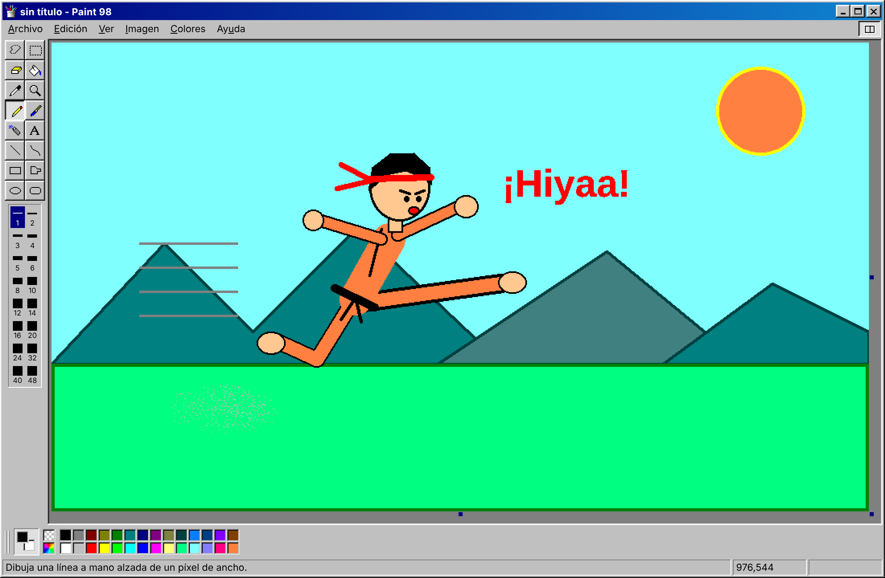
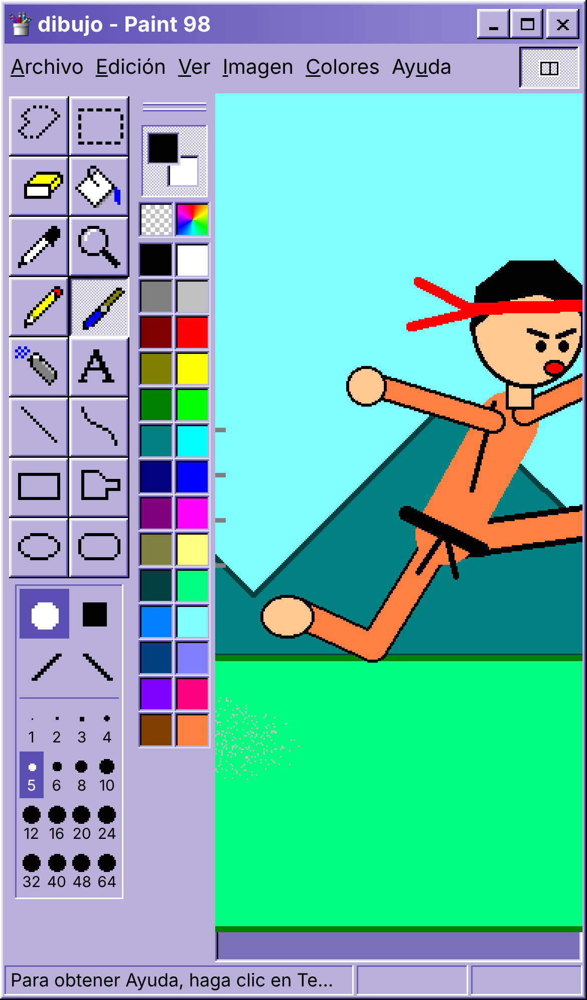
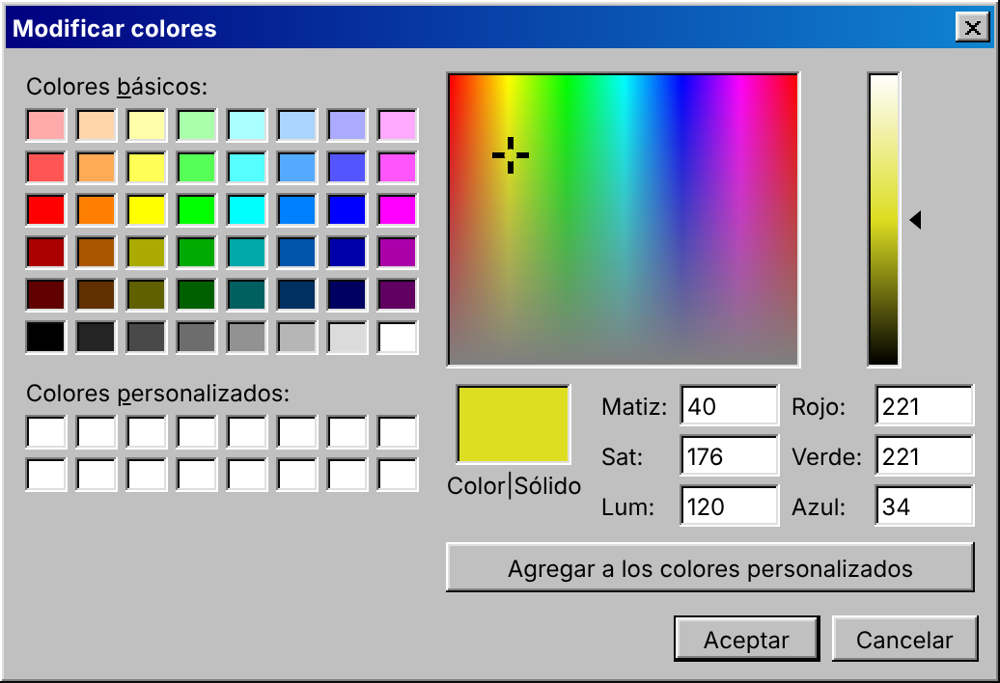
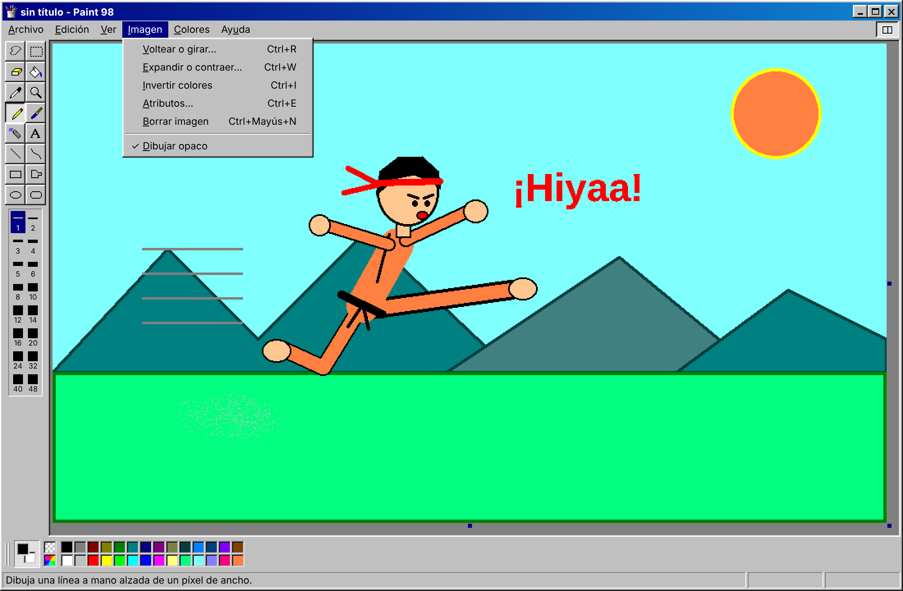
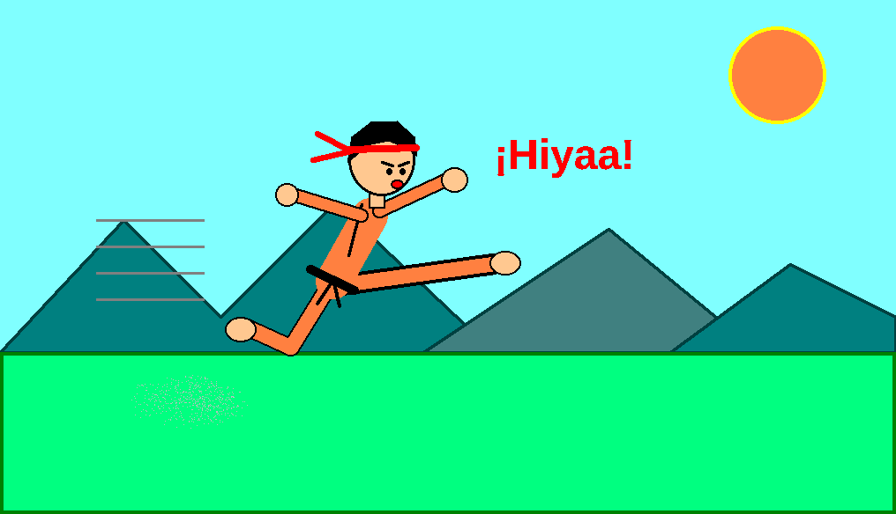

# Paint 98

Programa de dibujo para el navegador con el estilo de un escritorio de 1998.
Está hecho en JavaScript puro, sin instalar nada ni pasos de compilación, y
pensado sobre todo para usarse en el celular en vertical.



**Úsalo aquí:** https://gabom88.github.io/Paint-98/

Funciona sin conexión y se puede instalar en la pantalla de inicio
(en iPhone: Compartir ▸ "Agregar a inicio"; en Android: menú ▸ "Instalar app").

> Proyecto independiente, hecho como homenaje. No está relacionado con
> Microsoft ni con ningún producto suyo.

## Qué puede hacer

**Herramientas (16):** selección libre y rectangular, borrador (y borrador de
color con clic derecho), bote de pintura, cuentagotas, lupa, lápiz, pincel,
aerógrafo, texto, línea, curva, rectángulo, polígono, elipse y rectángulo
redondeado.

- **Gruesos:** lápiz, líneas y bordes de figuras de 1 a 48 px. Pincel de 1 a
  64 px en cuatro formas (redonda, cuadrada y dos diagonales). Borrador de 2 a
  128 px. Aerógrafo de 4 a 64 px.
- **Teclas + y −:** cambian el grueso de la herramienta actual, también
  mientras se está dibujando (antes de soltar el clic).
- **Borrador:** el cursor muestra un cuadro del tamaño real de la goma.
- **Figuras:** solo contorno, contorno con relleno o solo relleno. Con Mayús se
  dibujan cuadrados, círculos y líneas a 45°.
- **Selecciones:** se pueden mover, cambiar de tamaño, copiar (Ctrl + arrastrar)
  y dejar rastro (Mayús + arrastrar). Tienen modo opaco o transparente.

**Colores**

- Paleta de 28 colores. Clic izquierdo elige el color de dibujo y clic derecho
  (o mantener presionado en el celular) el color de fondo.
- **Color transparente** (el cuadro con cuadrícula): pinta transparencia. Al
  guardar como PNG, esa zona queda transparente de verdad.
- **Modificar colores:** cuadrícula de colores básicos, 16 colores
  personalizados y un espectro con barra de luminosidad para elegir cualquier
  color (matiz, saturación y luminosidad, o rojo, verde y azul).
- El cuadro de colores se arrastra por su agarradera para ponerlo **abajo,
  arriba o a la izquierda**.

**Menús**

- **Archivo:** nuevo, abrir o importar cualquier imagen, guardar como PNG,
  compartir, imprimir.
- **Edición:** deshacer y repetir, cortar, copiar, pegar, borrar selección,
  seleccionar todo, copiar en archivo y pegar desde archivo.
- **Ver:** mostrar u ocultar herramientas, colores, barra de estado y barra de
  texto; zoom de 100 % a 800 %; cuadrícula; ver la imagen a pantalla completa.
- **Imagen:** voltear o girar, expandir o inclinar, invertir colores, cambiar
  el tamaño (atributos), borrar imagen y dibujar opaco.

**Ventana**

- **5 temas de color:** Estándar, Desierto, Berenjena, Lila y Ladrillo. Se
  cambian tocando el ícono de arriba a la izquierda.
- El botón a la derecha del menú oculta las herramientas para dejar más
  espacio al dibujo.
- **Celular:** dos dedos mueven la imagen; si los separas o los juntas, la
  amplías o la reduces.
- **Guardado automático:** el dibujo se guarda solo en el dispositivo, así que
  no se pierde al cerrar.

## Capturas

| En el celular (tema Lila, colores a la izquierda) | Modificar colores |
|---|---|
|  |  |

**Menú Imagen**



**El dibujo exportado como PNG** (hecho con la propia app: figuras, polígonos,
líneas gruesas, aerógrafo, relleno y texto)



## Atajos de teclado

| Tecla | Acción |
|---|---|
| `+` / `−` | Más grueso / más delgado |
| `Ctrl+N` / `Ctrl+O` / `Ctrl+S` | Nuevo / Abrir / Guardar como PNG |
| `Ctrl+Z` / `Ctrl+Y` | Deshacer / Repetir |
| `Ctrl+X` / `Ctrl+C` / `Ctrl+V` | Cortar / Copiar / Pegar |
| `Ctrl+A` / `Supr` | Seleccionar todo / Borrar selección |
| `Ctrl+R` / `Ctrl+W` / `Ctrl+I` / `Ctrl+E` | Voltear o girar / Expandir / Invertir / Atributos |
| `Ctrl+T` / `Ctrl+L` | Mostrar u ocultar herramientas / colores |
| `Ctrl+G` / `Ctrl+F` | Cuadrícula / Ver imagen |
| `Ctrl + rueda del mouse` | Zoom |
| `Esc` | Cancelar lo que se está dibujando |
| `F1` | Ayuda |

## Probar en tu computadora

Solo necesitas Python (o cualquier servidor web sencillo):

```bash
python -m http.server 8080
```

y abre http://localhost:8080. No funciona abriendo `index.html` con doble
clic, porque el navegador no carga los módulos de JavaScript desde un archivo
local.

## Publicar en GitHub Pages

1. En el repositorio: **Settings ▸ Pages**.
2. En *Build and deployment*, *Source*: **Deploy from a branch**.
3. *Branch*: **main** y carpeta **/ (root)** ▸ **Save**.
4. En uno o dos minutos queda en https://gabom88.github.io/Paint-98/

Cada vez que se cambie algún archivo, sube el número de `CACHE` en `sw.js`
(por ejemplo `paint98-v5` → `paint98-v6`) para que los celulares que ya la
tienen instalada descarguen la versión nueva.

## Archivos

```
index.html            ← estructura de la ventana
css/paint.css         ← aspecto (relieves, temas, celular)
js/app.js             ← herramientas, menús, diálogos y archivos
js/raster.js          ← dibujo pixelado: líneas, figuras, relleno, colores
js/icons.js           ← íconos pixel-art de las herramientas
sw.js                 ← funcionamiento sin conexión
manifest.webmanifest  ← datos para instalarla como app
icons/                ← logo de la app
```
